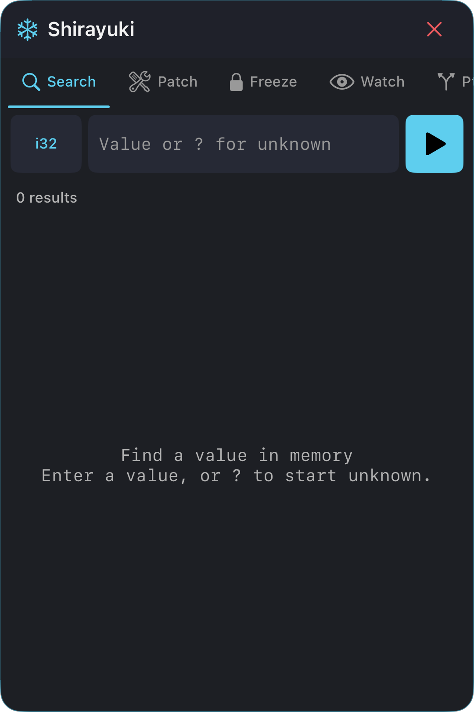
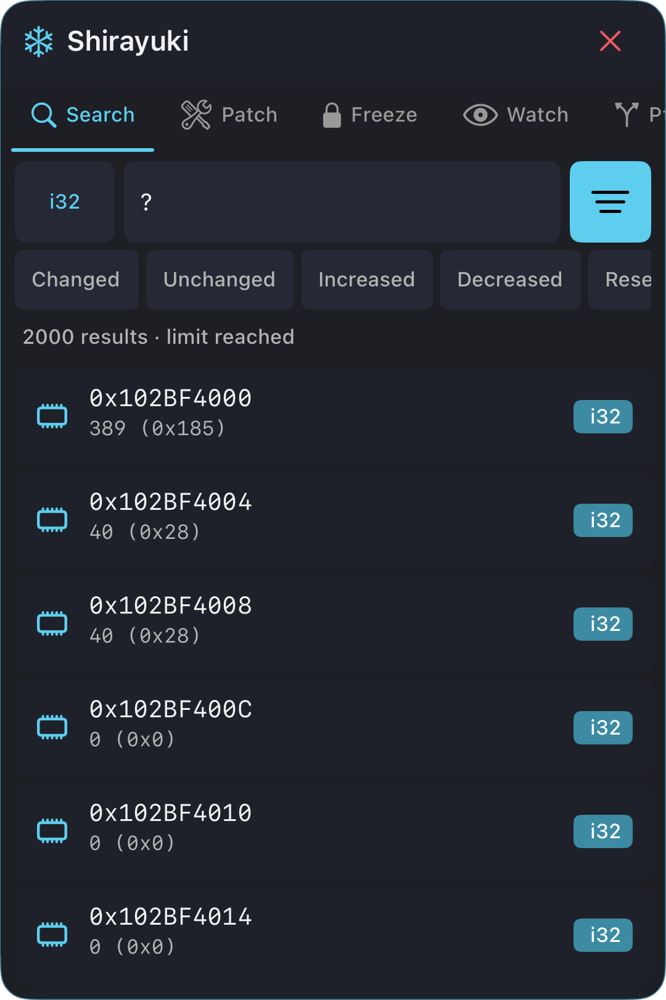
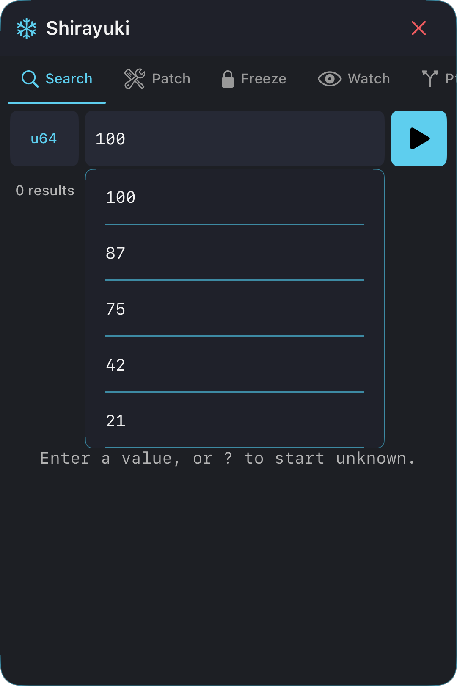

# ❄️ Shirayuki

<p align="center">
  
</p>

<p align="center">
  <b>In-app memory toolkit overlay for jailbroken iOS</b>
</p>

<p align="center">
  
  
  
  
  
  
</p>

---

Shirayuki injects a **floating overlay panel** into any app on a jailbroken iPhone.
Tap the snowflake button and start hacking — no respring per session.

**Tabs:** Search · Patch · Freeze · Watch · Pointer · Dump · Threads · Modules

## UI samples

Simulator captures of the UIKit panel. Addresses, values and history are examples.

<table>
  <tr>
    <th>Search</th>
    <th>Results and narrowing</th>
    <th>Recent searches</th>
  </tr>
  <tr>
    <td></td>
    <td></td>
    <td></td>
  </tr>
</table>

Choose a search type from the type menu. Each tab keeps its input, active scans
show a spinner, and the status line reports result counts and scan limits.

## Install

Grab the `.deb` from [Releases](https://github.com/qusamulab/shirayuki/releases) and
install it with a file manager or `dpkg -i`. Requires a jailbroken **iOS 15.0+
arm64** device with **ElleKit** (rootless) or **Substrate/Substitute** (rooted).

Packages are built rootless, which is what palera1n, Dopamine and XinaA15 use.

## Build

```bash
export THEOS_DEVICE_IP=192.168.x.x
make package install
```

Requires [Theos](https://theos.dev).

## Develop

Theos is **not** needed for these — any machine with Xcode will do:

```bash
make test           # run the C++ core suite natively (6 suites, 592 checks)
make syntax-check   # compile and link every source against the iPhoneOS SDK
make check          # fmt-check + test + syntax-check
```

## Documentation

📖 **<https://qusamulab.github.io/shirayuki>**

| | |
|---|---|
| [Install](docs/install.md) | Rooted vs rootless, verifying it loaded, troubleshooting |
| [Usage](docs/usage.md) | Finding a value, freezing it, patching, pointer chains |
| [Features](docs/features.md) | What each tab does, and what is core-API-only |
| [Architecture](docs/architecture.md) | Layering, the C++/ObjC boundary, invariants |
| [C++ API](docs/api.md) | Using `ShirayukiMemory/` directly |
| [Development](docs/development.md) | Test suite, verification without a device |
| [Release](docs/release.md) | Versioning and how a release is cut |

Contributor conventions live in [CLAUDE.md](CLAUDE.md).

---

> For security research, CTF challenges, and educational use on devices you own.
